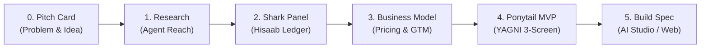

# Idea to App Prompt Kit — Team-Auralis Edition

[](https://github.com/Team-Auralis)
[](LICENSE)
[](#)

An enterprise-grade, zero-dependency interactive startup development platform and MVP stress-testing cockpit designed by **Team-Auralis** for founders, engineers, and product strategists.

Runs directly in any modern browser as a standalone web application. **100% client-side, offline-capable, and zero tracking.**

---

## 🌟 Platform Capabilities

### 1. 🌐 Agent Reach Multi-Platform Reconnaissance (16 Platforms)
Automated internet reconnaissance query generators across Search, Social, Developer, and Video platforms:
* **Exa Web Search**: Pinpoints recent market reports and startup post-mortems
* **Reddit & X Pain Hunter**: Uncovers unfiltered consumer complaints, rage tweets, and pricing rants
* **GitHub Codebase Audit**: Audits existing open-source implementations and competitor tech stacks
* **YouTube Harvester**: Analyzes consumer review vlogs and on-the-ground reality

### 2. 🦈 The 5-Shark Indian Venture Courtroom
Judged by five battle-tested investor personas with authentic sector heuristics:
* 💰 **TIJORI — The Money Shark**: Cash flow velocity, payment cycles, 90-day credit traps, and pricing power (*"Revenue is vanity, profit is sanity, but cash flow is reality."*)
* 🛒 **BAZAAR — The Customer & GTM Shark**: ICP clarity, CAC, Tier-2/3 Indian willingness to pay, and WhatsApp k-factor (*"If you are selling to everyone in India, you are selling to no one."*)
* 🧮 **HISAAB — The Numbers Shark**: Unit economics, CM1, CM2, CM3, and break-even math (*"Numbers never lie, but founders often lie to their spreadsheets."*)
* ⚔️ **TAKKAR — The Rivals & Moats Shark**: Incumbents (Swiggy, Blinkit, WhatsApp), copycat defenses, and switching friction (*"What is your moat when a giant copies your feature set on Friday afternoon?"*)
* 👑 **DADA — The Founder Shark**: Founder-market fit, execution grit, domain insight, and local unfair advantage (*"Ideas are cheap; execution and endurance are everything. Why YOU?"*)

### 3. 🧮 Mathematically Validated Financial Engine (5 Sectors)
Adapts dynamically to the founder's selected business model:
* **D2C & Consumer Brands**: MRP, landed COGS, courier shipping, 20% Indian COD/RTO return freight provision, 2% payment gateway, and performance CAC. Computes **CM1** (Gross), **CM2** (Delivered), and **CM3** (Net per Unit).
* **SaaS & AI Wrapper**: Monthly ARPU, cloud & Gemini API token costs per user, variable gateway fee, and subscriber CAC. Computes Gross Margin %, Monthly CM2, **CAC Payback Period (Months)**, and Breakeven Subscribers.
* **Marketplace & Platform**: Average Order Value (AOV), Commission Take Rate %, delivery subsidy, and blended 2-sided CAC. Computes Platform Gross Take, Order CM2, and Breakeven Monthly GMV.
* **B2B & Enterprise Services**: Annual Contract Value (ACV), Implementation/Onboarding COGS, Annual Support SLA, and Enterprise Sales CAC. Computes Contract Margins and Breakeven Annual Deals.
* **Offline Retail & Hardware**: Retail MRP, BOM manufacturing cost, distributor margin (25%), warehousing freight, and retail sampling CAC.

*Baseline overhead assumption: ₹15,000/month (domain, hosting, Gemini API token budget, basic student stipend).*

### 4. ✂️ Ponytail Lazy Senior Dev Mode & Bloat-Slasher
Built on the Ponytail engineering doctrine:
* *"The best code is the code never written. Shortest working diff wins."*
* **Interactive Bloat Meter**: Audits and slashes unnecessary architecture traps (Custom OAuth servers, heavy SQL clusters, microservices, native mobile apps, vector DB bloat) from weeks of dev into a 1-day MVP.
* **1-Click Ponytail Trim**: Strips away bloat toggles to achieve instant 0% bloat.

### 5. 🔄 Structured Handoff Engine & Pipeline Flow
* **Resilient Extraction Parser**: Extracts deliverables from raw text, markdown bold (`**LABEL:**`), numbered lists (`1. LABEL:`), and full conversational chat outputs.
* **Live Extraction Status Chips**: Displays visual feedback badges (`✓ Problem`, `✓ First Users`, `✓ Moat Rating`) showing exact parsed deliverables.
* **Raw AI Preservation**: Preserves the complete raw text in `st.rawHandoffs` so no original LLM analysis is ever lost.
* **User Field Overrides**: Founders can inspect and modify specific parsed deliverables, with edits dynamically propagated into downstream station prompts.
* **Station 5 Master Synthesis**: Automatically compiles approved deliverables from all 4 stations into a complete single-file HTML/CSS/JS build prompt with 6 post-build Quick Fix polish prompts.

### 6. 🛡️ Security, Privacy & Compliance
* **Zero Telemetry**: All data stays inside your browser (`localStorage`). No tracking pixels, cookies, or remote analytics.
* **Content Security Policy (CSP)**: Strict meta tag enforcement preventing unauthorized script execution and restricted network connections.
* **Sanitized DOM Output**: XSS-safe `textContent` on toast notifications and HTML entity encoding (`esc()`) on all interpolated strings.
* **Anti-Prototype Poisoning**: Project JSON import engine validates schema, strips dangerous properties (`__proto__`, `constructor`), and caps string lengths (max 20,000 chars/field).

### 7. 🎨 Accessible Responsive UX (WCAG 2.1 AA)
* **Mobile-First Responsive Layout**: Optimized for 360px mobile viewports through 1440px desktop displays. Includes safe-area inset paddings for notched screens.
* **Fixed Mobile Bottom Action Bar**: Tactile touch navigation (Prev, Next, Copy Prompt, Open Tool) with 44px+ hit targets.
* **Bilingual Support**: Instant toggle between English and Telugu (తెలుగు) covering all UI labels, shark quotes, and senior dev guidelines.
* **Theme Switching**: Dark and Light themes with system auto-detection and persistence.
* **Full Project Portability**: One-click **Export Project JSON** (`.json`), **Import Project JSON**, and **Copy Founder Dossier** (`.md`).

---

## 🚀 The 5-Station Engineering Journey



1. **Station 1: Problem & Market Reconnaissance** (Gemini Deep Research + 16-Platform Recon)
2. **Station 2: The 5-Shark Indian Venture Grill** (Courtroom Grilling + Live Unit Economics Ledger)
3. **Station 3: Business Model & Pricing Strategy** (INR Monetization, Zero-Dollar GTM, Elevator Pitch)
4. **Station 4: Ponytail Bloat-Slasher MVP** (YAGNI Filter, 3-Screen Architecture, Single Killer AI Feature)
5. **Station 5: Master Website Build Specification** (AI Studio & Antigravity executable web prompt + 6 Quick Fix prompts)

---

## 💻 How to Run

Simply open [`index.html`](index.html) in any modern web browser:
```powershell
Start-Process "D:\idea\index.html"
```
No installation, npm packages, or backend server required.

---

## 🧪 Automated Test Suite

The platform includes a comprehensive automated test suite executable via Node.js:

```powershell
# Run all test suites
node "scratch/suite_1_finance_unit.js"       # 5 sector financial models & zero boundary tests
node "scratch/suite_2_pipeline_integration.js" # Station context flow, handoff parsing, user overrides
node "scratch/suite_3_security_xss.js"        # CSP, XSS entity escaping, and safe JSON import
node "scratch/suite_4_accessibility_wcag.js"  # WCAG 2.1 AA form label bindings & ARIA landmarks
node "scratch/suite_5_e2e_journey.js"         # Full 5-station journey & export/import roundtrip
```

### Test Results Summary:
* **Suite 1 (Financial Models):** 5/5 PASSED (D2C, SaaS, Marketplace, B2B, Zero Boundaries)
* **Suite 2 (Pipeline Flow):** 5/5 PASSED (Context passing, raw preservation, field overrides, build prompt)
* **Suite 3 (Security & XSS):** 4/4 PASSED (Strict CSP, entity escaping, safe JSON import, textContent toast)
* **Suite 4 (Accessibility):** 5/5 PASSED (11/11 explicit label associations, ARIA landmarks, single h1)
* **Suite 5 (End-to-End):** 6/6 PASSED (Sequential unlock, handoff processing, export/import roundtrip)

---

## 📜 Changelog

### v3.0.0 (Current Release)
* **Sector-Adaptive Financial Engine**: Added specialized unit economics calculators for D2C, SaaS, Marketplace, B2B, and Retail.
* **Strict Security Hardening**: Added Content Security Policy (CSP), prototype-pollution protection in JSON imports, and entity escaping.
* **Structured Handoff Engine**: Added visual deliverable status chips, raw AI text preservation, and user deliverable overrides.
* **Full Mobile & Accessibility Overhaul**: Sticky stepper navigation, fixed bottom action bar, explicit label `for` associations, and WCAG 2.1 AA compliance.
* **Complete Bilingual Support**: High-fidelity English and Telugu (తెలుగు) dictionaries across all UI copy.
* **Portable Project Management**: Schema-validated JSON Export and Import capabilities.

### v2.0.0
* Added Agent Reach 16-platform reconnaissance queries.
* Added 5-Shark Indian pitch courtroom with Hisaab unit economics ledger.
* Integrated Ponytail Bloat-Slasher MVP mode.

### v1.0.0
* Initial release of the 5-station prompt kit.

---

## 👥 Maintained by

**Team-Auralis** — Applied AI Research, Systems Architecture & Intelligent Autonomous Tools.  
GitHub: [https://github.com/Team-Auralis](https://github.com/Team-Auralis)
